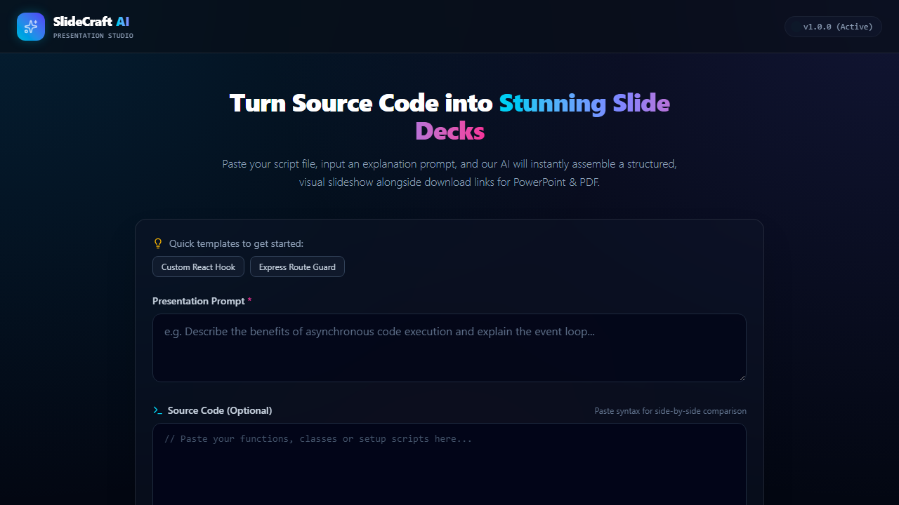
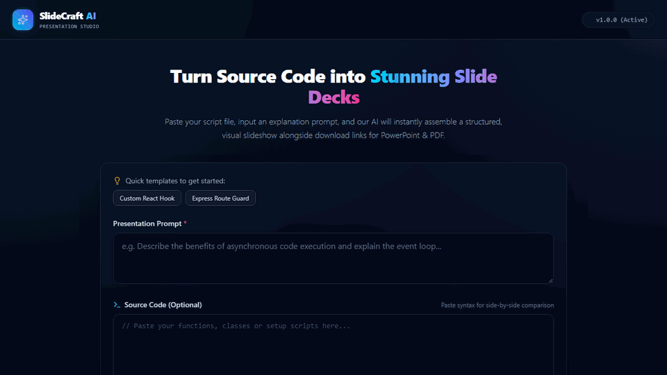

# AI Presentation Generator 📊✨

An automated presentation generation platform that transforms natural language prompts and research briefs into structured, professional PowerPoint (`.pptx`) decks and PDF slides using **Google Gemini AI** and **Puppeteer / PptxGenJS**.

---

## 📸 Preview & Live Walkthrough





> 🎬 **[Watch Full Demo Video (WebM)](./docs/demo.webm)**

---

## 🌟 Key Features

* **Prompt-to-Deck Generation:** Converts rough user topics or text dumps into clean slide outlines with structured bullet points, speaker notes, and key takeaways using `@google/genai`.
* **Multi-Format Export:**
  * Native PowerPoint (`.pptx`) generation via `pptxgenjs`.
  * High-fidelity slide-by-slide PDF generation using headless Puppeteer rendering.
* **Modern Reactive Interface:** Clean, responsive UI with real-time loading feedback, slide preview gallery, and instant download buttons.

---

## 🛠️ Tech Stack

* **Frontend:** React 18, Vite, Lucide React, Axios, CSS Modules
* **Backend:** Node.js, Express.js, Google Gemini API (`@google/genai`), Puppeteer, PptxGenJS
* **AI Engine:** Gemini 2.5 / 1.5 Flash structured output mode

---

## 🚀 Quick Start Guide

### 1. Prerequisites
* Node.js (v18+)
* Google Gemini API Key ([aistudio.google.com](https://aistudio.google.com))

### 2. Backend Setup
```bash
cd backend
npm install
# Copy .env.example to .env and insert your GEMINI_API_KEY
npm run dev
```

### 3. Frontend Setup
```bash
cd frontend
npm install
npm run dev
```

---

## 🛡️ License
MIT License. Built by Yash P Chavan.
